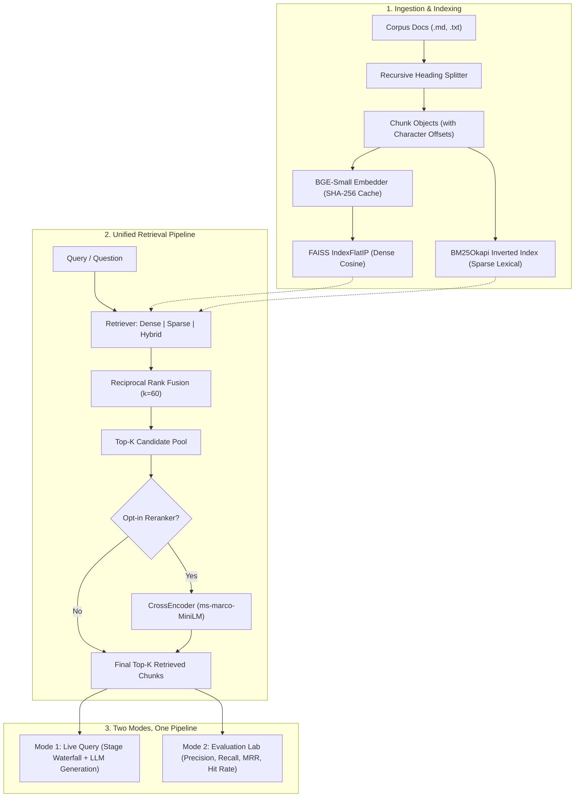

# rag-eval-lab: Engineering Platform for Evaluating & Benchmarking RAG Systems

[](https://github.com/Shauryakant/Rag-Evaluation-System/actions)
[](LICENSE)
[](https://www.python.org/)
[](https://nextjs.org/)

An engineering platform for building, evaluating, and benchmarking Retrieval-Augmented Generation (RAG) architectures—**not a chatbot wrapper**.

**Zero framework abstractions.** No LangChain, no LangGraph, no black-box retrieval wrappers. Every stage—from heading-aware chunking and FAISS/BM25 indexing to Reciprocal Rank Fusion, span-based ground truth resolution, and CrossEncoder reranking—is explicitly hand-written and unit-tested so every algorithmic trade-off can be measured and explained in an engineering interview.

---

## 🏛️ System Architecture



---

## 🎯 Product Shape: Two Modes, One Pipeline

1. **Mode 1: Ad-hoc Query (`/query`)**
   - Live question answering against the benchmark corpus.
   - Inspect retrieved passages, relevance scores, and an exact stage-by-stage latency waterfall (retrieval vs reranker vs generation).
   - **Critical Design Rule 4:** No synthetic accuracy scores are fabricated on ad-hoc questions. Live questions have no predefined ground truth.
2. **Mode 2: Evaluation Lab (`/evaluation`)**
   - Runs the **exact same retriever function** against 40 labelled technical benchmark questions.
   - Evaluates Recall@K, Mean Reciprocal Rank (MRR), Hit Rate, and Precision@K with per-query failure inspection.
   - **Critical Design Rule 1:** Ground truth is anchored to **verbatim text spans**, not fragile chunk IDs, dynamically resolved against the live index.
3. **Benchmarks Matrix (`/benchmarks`)**
   - Full parameter sweep matrix across 18 configurations (`retriever × top_k × reranker`).
   - One-click CSV export (`/api/benchmarks/csv`).

---

## 📊 Real Measured Benchmark Results

All figures below are **real empirical measurements** generated over our 40-question benchmark set:

| Retriever | Top K | CrossEncoder Reranker | Recall@K | MRR | Hit Rate | Precision@K | Latency (CPU) |
| :--- | :---: | :---: | :---: | :---: | :---: | :---: | :---: |
| **Dense (FAISS)** | 3 | Off | 0.8750 | 0.7583 | 0.8750 | 0.2916 | 17.25 ms |
| **Dense (FAISS)** | 3 | **On** | **0.9750** | **0.9375** | **0.9750** | 0.3250 | 484.81 ms |
| **Dense (FAISS)** | 5 | Off | 0.9500 | 0.7733 | 0.9500 | 0.1900 | **0.36 ms** |
| **Dense (FAISS)** | 5 | **On** | **0.9750** | **0.9375** | **0.9750** | 0.1950 | 316.67 ms |
| **Dense (FAISS)** | 10 | Off | 0.9750 | 0.7761 | 0.9750 | 0.0975 | 0.88 ms |
| **Dense (FAISS)** | 10 | **On** | 0.9750 | **0.9375** | 0.9750 | 0.0975 | 655.84 ms |
| **Sparse (BM25)** | 3 | Off | 0.9500 | 0.8875 | 0.9500 | 0.3166 | 0.49 ms |
| **Sparse (BM25)** | 3 | **On** | **0.9750** | **0.9375** | **0.9750** | 0.3250 | 465.76 ms |
| **Sparse (BM25)** | 5 | Off | 0.9750 | 0.8938 | 0.9750 | 0.1950 | **0.38 ms** |
| **Sparse (BM25)** | 5 | **On** | **0.9750** | **0.9375** | **0.9750** | 0.1950 | 454.76 ms |
| **Sparse (BM25)** | 10 | Off | 0.9750 | 0.8938 | 0.9750 | 0.0975 | 0.37 ms |
| **Sparse (BM25)** | 10 | **On** | 0.9750 | **0.9375** | 0.9750 | 0.0975 | 658.00 ms |
| **Hybrid (RRF)** | 3 | Off | 0.9750 | 0.8250 | 0.9750 | 0.3250 | 1.46 ms |
| **Hybrid (RRF)** | 3 | **On** | **0.9750** | **0.9375** | **0.9750** | 0.3250 | 449.29 ms |
| **Hybrid (RRF)** | 5 | Off | 0.9750 | 0.8250 | 0.9750 | 0.1950 | 1.39 ms |
| **Hybrid (RRF)** | 5 | **On** | **0.9750** | **0.9375** | **0.9750** | 0.1950 | 453.49 ms |
| **Hybrid (RRF)** | 10 | Off | **1.0000** | 0.8275 | **1.0000** | 0.1000 | **1.42 ms** |
| **Hybrid (RRF)** | 10 | **On** | 0.9750 | **0.9375** | 0.9750 | 0.0975 | 664.37 ms |

---

## 💡 Core Empirical Finding

> **Hybrid Retrieval (Reciprocal Rank Fusion $k=60$) achieves 100% Hit Rate and 1.0000 Recall@10 in only 1.42 ms on CPU without reranking.**  
> While the CrossEncoder reranker (`ms-marco-MiniLM-L-6-v2`) elevates Dense MRR from **0.758 to 0.938**, it adds **~316ms to 650ms** of CPU latency per query (~28x to 450x slower). Therefore, reranking is implemented strictly as an **opt-in** parameter rather than a hidden latency penalty.

### Understanding the Precision@K Structural Ceiling
Notice that Precision@K decreases from ~0.32 at $K=3$ to ~0.19 at $K=5$ and ~0.09 at $K=10$. This is mathematically expected: because each query in a targeted benchmark has 1-2 relevant passages in the corpus, retrieving $K$ passages structurally bounds Precision to $\le |GT| / K$. **Recall@K** and **MRR** are the primary signals of retrieval effectiveness.

---

## 🛠️ Tech Stack & Directory Layout

- **Backend:** Python 3.11, FastAPI, Pydantic, `sentence-transformers` (`BAAI/bge-small-en-v1.5`), `faiss-cpu` (`IndexFlatIP`), `rank_bm25`, `CrossEncoder` (`cross-encoder/ms-marco-MiniLM-L-6-v2`), `groq` (`llama-3.1-8b-instant`), `pytest`.
- **Frontend:** Next.js 15 (App Router), TypeScript, TanStack Query, Tailwind CSS, Lucide Icons.

```
rag-eval-lab/
├── backend/
│   ├── config.py                 # Central settings & env definitions
│   ├── ingestion/loader.py       # Corpus document loader
│   ├── chunking/splitter.py      # Recursive heading-aware text splitter
│   ├── embeddings/embedder.py    # bge-small with SHA-256 disk cache
│   ├── retrieval/
│   │   ├── faiss_store.py        # IndexFlatIP exact cosine search
│   │   ├── bm25_store.py         # BM25Okapi sparse lexical search
│   │   ├── hybrid.py             # Reciprocal Rank Fusion (k=60)
│   │   ├── reranker.py           # CrossEncoder (ms-marco-MiniLM-L-6-v2)
│   │   └── service.py            # Unified RetrievalService (identical code path)
│   ├── generation/
│   │   ├── prompt_builder.py     # Grounded prompt construction & citation formatting
│   │   └── groq_generator.py     # Llama 3 generation with offline fallback
│   ├── evaluation/
│   │   ├── ground_truth.py       # Span-based live index ground truth resolver
│   │   ├── metrics.py            # Pure IR metrics (precision, recall, mrr, hit_rate)
│   │   └── benchmark_runner.py   # 18-config parameter sweep runner
│   ├── api/                      # FastAPI routers (query, evaluation, benchmarks, health)
│   ├── data/corpus/              # 8 technical benchmark documents
│   ├── data/testset.json         # 40 labelled questions with verbatim text spans
│   ├── results/benchmark.csv     # Precomputed benchmark sweep results
│   ├── tests/                    # 42 unit and integration tests (100% pass)
│   ├── Dockerfile
│   └── requirements.txt
├── frontend/
│   ├── app/                      # Overview (/), Query (/query), Evaluation (/evaluation), Benchmarks (/benchmarks), About (/about)
│   ├── components/               # Navbar, ChunkCard, LatencyWaterfall, QueryProvider
│   ├── hooks/                    # TanStack Query hooks
│   ├── services/api.ts           # Centralized API service client
│   └── types/index.ts            # Hand-written TypeScript definitions
├── docs/
│   ├── decisions/                # 3 Architectural Decision Records (ADRs)
│   ├── benchmark_report.md       # Comprehensive evaluation report
│   └── deployment.md             # HF Spaces, Render, and Vercel setup
├── Dockerfile                    # Root container build for HF Spaces / Render
├── render.yaml                   # Render Blueprint spec
└── .github/workflows/ci.yml      # GitHub Actions CI matrix
```

---

## ⚡ Quickstart: Running Locally

### 1. Backend Setup
```bash
# In repository root
python -m venv venv
# Windows: venv\Scripts\activate | Unix: source venv/bin/activate
pip install -r backend/requirements.txt

# Run test suite (42 tests)
pytest backend/tests/

# Start FastAPI backend server
uvicorn backend.main:app --host 0.0.0.0 --port 8000 --reload
```
*Backend Swagger Docs:* `http://localhost:8000/docs`

### 2. Frontend Setup
```bash
cd frontend
npm install
npm run dev
```
*Frontend UI:* `http://localhost:3000`

---

## 📦 Deployment

- **Backend:** Hugging Face Spaces (Docker SDK) or Render free tier. Container image bakes pre-downloaded model weights and precomputed benchmark artifacts to eliminate cold-start download delays.
- **Frontend:** Vercel. Set Root Directory to `frontend` and configure `NEXT_PUBLIC_API_URL`.
- Complete instructions are documented in [docs/deployment.md](docs/deployment.md).

---

## ⚠️ Limitations & Realities

1. **Benchmark Scale:** Evaluated across 40 questions and 8 technical documents. At enterprise scale ($10^6$ passages), exhaustive flat indices must be replaced with tiered approximate indices (such as HNSW).
2. **CPU Execution:** Latencies reported were measured on commodity CPU. On dedicated GPU inference, CrossEncoder reranking drops from ~450ms to ~20ms.
3. **In-Memory Storage:** FAISS and BM25 indices reside in memory. Multi-replica scaling requires external vector store persistence or shared memory mounts.

---

## 📄 Architecture Decision Records
- [ADR-001: Embedding Model Selection (BAAI/bge-small-en-v1.5)](docs/decisions/001_embedding_model_selection.md)
- [ADR-002: Vector Store Selection (FAISS IndexFlatIP)](docs/decisions/002_vector_store_selection.md)
- [ADR-003: Dense vs. Hybrid Retrieval Trade-offs](docs/decisions/003_dense_vs_hybrid_retrieval.md)
