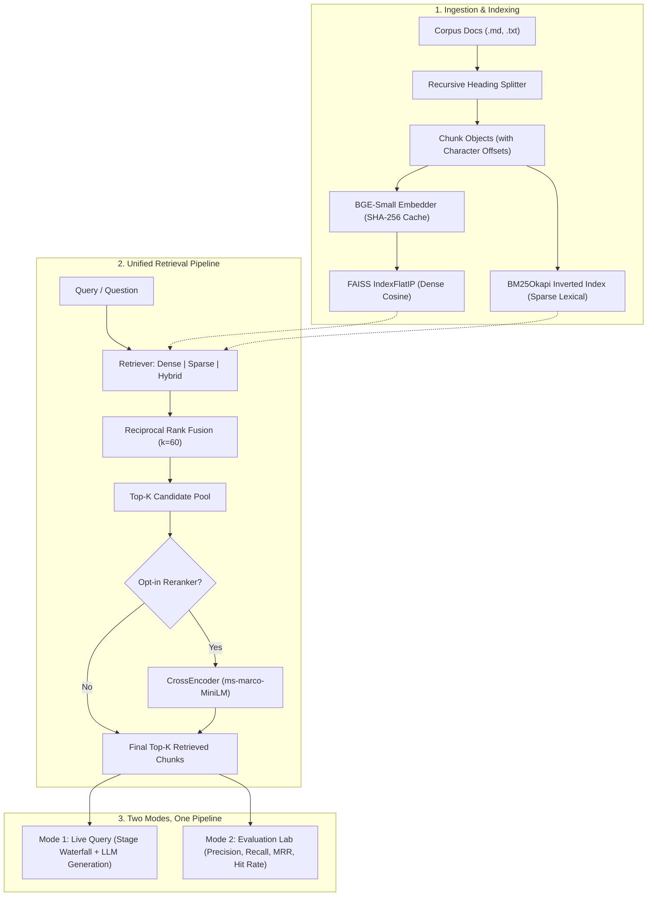

# rag-eval-lab: Engineering Platform for Evaluating & Benchmarking RAG Systems

[](https://github.com/Shauryakant/Rag-Evaluation-System/actions)
[](LICENSE)
[](https://www.python.org/)
[](https://nextjs.org/)

An engineering platform for building, evaluating, and benchmarking Retrieval-Augmented Generation (RAG) architectures—**not a chatbot wrapper**.

**Zero framework abstractions.** No LangChain, no LangGraph, no black-box retrieval wrappers. Every stage—from heading-aware chunking and FAISS/BM25 indexing to Reciprocal Rank Fusion, span-based ground truth resolution, and CrossEncoder reranking—is explicitly hand-written and unit-tested so every algorithmic trade-off can be measured and explained in an engineering interview.

---

## 🏛️ System Architecture



---

## 🎯 Product Shape: Two Modes, One Pipeline

1. **Mode 1: Ad-hoc Query (`/query`)**
   - Live question answering against the benchmark corpus.
   - Inspect retrieved passages, relevance scores, and an exact stage-by-stage latency waterfall (retrieval vs reranker vs generation).
   - **Critical Design Rule 4:** No synthetic accuracy scores are fabricated on ad-hoc questions. Live questions have no predefined ground truth.
2. **Mode 2: Evaluation Lab (`/evaluation`)**
   - Runs the **exact same retriever function** against 40 labelled technical benchmark questions.
   - Evaluates Recall@K, Mean Reciprocal Rank (MRR), Hit Rate, and Precision@K with per-query failure inspection.
   - **Critical Design Rule 1:** Ground truth is anchored to **verbatim text spans**, not fragile chunk IDs, dynamically resolved against the live index.
3. **Benchmarks Matrix (`/benchmarks`)**
   - Full parameter sweep matrix across 18 configurations (`retriever × top_k × reranker`).
   - One-click CSV export (`/api/benchmarks/csv`).

## 📚 Benchmark Corpus & Ground Truth (Real Wikipedia Data)

Unlike synthetic question-answer toys, `rag-eval-lab` is evaluated against **real-world Wikipedia articles** extracted from Stanford's **SQuAD v2.0** benchmark:

- **8 Real Wikipedia Articles** (`backend/data/corpus/`):
  - `normans.md` — Norman history, conquests, and cultural impact
  - `computational_complexity_theory.md` — P vs NP, complexity classes, and reduction theory
  - `steam_engine.md` — Thermodynamic cycles, Watt engines, and industrial revolution history
  - `oxygen.md` — Molecular chemistry, allotropes, photosynthesis, and respiration
  - `huguenot.md` — French Protestant Reformation and historical diaspora
  - `southern_california.md` — Geography, climate, urban demographics, and economy
  - `victoria_australia.md` — Australian colonial history, gold rush, and regional governance
  - `sky_united_kingdom.md` — Commercial broadcasting, satellite television, and digital platforms
- **Corpus Scale:** **633 chunks** (~204,485 raw characters) processed via heading-aware recursive chunking (chunk size 500, overlap 50).
- **40 Labelled Benchmark Questions** (`backend/data/testset.json`): Human-verified technical queries with exact **verbatim text spans**.
- **Dynamic Span Resolution (Design Rule 1):** Ground truth is anchored to exact substring spans rather than fragile chunk IDs. If chunking parameters change, ground truth chunks are re-resolved dynamically on the fly. Missing or ambiguous spans raise explicit runtime assertion errors.

---

## 📊 Real Measured Benchmark Results (SQuAD Wikipedia Benchmark)

All figures below are **real empirical measurements** generated across **633 real Wikipedia chunks** and **40 human-verified questions** from SQuAD v2.0:

| Retriever | Top K | CrossEncoder Reranker | Recall@K | MRR | Hit Rate | Precision@K | Latency (CPU) |
| :--- | :---: | :---: | :---: | :---: | :---: | :---: | :---: |
| **Dense (FAISS)** | 3 | Off | 0.7500 | 0.6667 | 0.7500 | 0.2500 | 20.76 ms |
| **Dense (FAISS)** | 3 | **On** | **0.9250** | **0.8458** | **0.9250** | 0.3083 | 519.98 ms |
| **Dense (FAISS)** | 5 | Off | 0.8500 | 0.6904 | 0.8500 | 0.1700 | **1.03 ms** |
| **Dense (FAISS)** | 5 | **On** | **0.9250** | **0.8458** | **0.9250** | 0.1850 | 281.62 ms |
| **Dense (FAISS)** | 10 | Off | 0.9250 | 0.7005 | 0.9250 | 0.0925 | **0.61 ms** |
| **Dense (FAISS)** | 10 | **On** | 0.9250 | **0.8458** | 0.9250 | 0.0925 | 391.40 ms |
| **Sparse (BM25)** | 3 | Off | 0.7500 | 0.6417 | 0.7500 | 0.2500 | 1.73 ms |
| **Sparse (BM25)** | 3 | **On** | 0.8750 | 0.8250 | 0.8750 | 0.2916 | 285.43 ms |
| **Sparse (BM25)** | 5 | Off | 0.8000 | 0.6517 | 0.8000 | 0.1600 | 1.52 ms |
| **Sparse (BM25)** | 5 | **On** | 0.8750 | 0.8250 | 0.8750 | 0.1750 | 285.71 ms |
| **Sparse (BM25)** | 10 | Off | 0.8500 | 0.6576 | 0.8500 | 0.0850 | 1.44 ms |
| **Sparse (BM25)** | 10 | **On** | **0.9750** | **0.8644** | **0.9750** | 0.0975 | 391.02 ms |
| **Hybrid (RRF)** | 3 | Off | 0.7750 | 0.6458 | 0.7750 | 0.2583 | 2.56 ms |
| **Hybrid (RRF)** | 3 | **On** | **0.9250** | **0.8458** | **0.9250** | 0.3083 | 285.15 ms |
| **Hybrid (RRF)** | 5 | Off | **0.8750** | 0.6683 | **0.8750** | 0.1750 | **2.68 ms** |
| **Hybrid (RRF)** | 5 | **On** | **0.9250** | **0.8458** | **0.9250** | 0.1850 | 308.57 ms |
| **Hybrid (RRF)** | 10 | Off | **0.9500** | 0.6778 | **0.9500** | 0.0950 | **2.67 ms** |
| **Hybrid (RRF)** | 10 | **On** | 0.9250 | **0.8458** | 0.9250 | 0.0925 | 390.25 ms |

---

## 💡 Core Empirical Findings

> **1. Hybrid RRF ($k=10$) delivers 95.0% Recall in 2.67 ms on CPU.**  
> Reciprocal Rank Fusion ($k_{rrf}=60$) effectively fuses dense semantic representation with BM25 keyword matching, retrieving relevant passages with high recall across 633 chunks in sub-3ms latency.  
>  
> **2. CrossEncoder Reranking Trade-Off:**  
> The CrossEncoder reranker (`ms-marco-MiniLM-L-6-v2`) boosts Mean Reciprocal Rank (MRR) from **0.678 to 0.846–0.864** (with Sparse+Rerank hitting **97.5% Recall**), but adds **~280ms to 520ms** of CPU latency per query (>100x slower). Reranking is therefore strictly opt-in.

### Understanding the Precision@K Structural Ceiling
Notice that Precision@K naturally scales as ~0.25 at $K=3$, ~0.17 at $K=5$, and ~0.09 at $K=10$. This is mathematically expected: in targeted benchmark datasets where each question has 1-2 ground-truth passages in the corpus, retrieving $K$ passages structurally bounds Precision to $\le |GT| / K$. **Recall@K** and **MRR** are the primary signals of retrieval quality.

---

## 🛠️ Tech Stack & Directory Layout

- **Backend:** Python 3.11, FastAPI, Pydantic, `sentence-transformers` (`BAAI/bge-small-en-v1.5`), `faiss-cpu` (`IndexFlatIP`), `rank_bm25`, `CrossEncoder` (`cross-encoder/ms-marco-MiniLM-L-6-v2`), `groq` (`openai/gpt-oss-120b`), `pytest`.
- **Frontend:** Next.js 15 (App Router), TypeScript, TanStack Query, Tailwind CSS, Lucide Icons.

```
rag-eval-lab/
├── backend/
│   ├── config.py                 # Central settings & env definitions
│   ├── ingestion/
│   │   ├── loader.py             # Corpus document loader
│   │   └── ingest_squad.py       # SQuAD v2.0 real Wikipedia ingestion pipeline
│   ├── chunking/splitter.py      # Recursive heading-aware text splitter
│   ├── embeddings/embedder.py    # bge-small with SHA-256 disk cache
│   ├── retrieval/
│   │   ├── faiss_store.py        # IndexFlatIP exact cosine search
│   │   ├── bm25_store.py         # BM25Okapi sparse lexical search
│   │   ├── hybrid.py             # Reciprocal Rank Fusion (k=60)
│   │   ├── reranker.py           # CrossEncoder (ms-marco-MiniLM-L-6-v2)
│   │   └── service.py            # Unified RetrievalService (identical code path)
│   ├── generation/
│   │   ├── prompt_builder.py     # Grounded prompt construction & citation formatting
│   │   └── groq_generator.py     # Groq LLM generation with dynamic reload & model fallback
│   ├── evaluation/
│   │   ├── ground_truth.py       # Span-based live index ground truth resolver
│   │   ├── metrics.py            # Pure IR metrics (precision, recall, mrr, hit_rate)
│   │   └── benchmark_runner.py   # 18-config parameter sweep runner
│   ├── api/                      # FastAPI routers (query, evaluation, benchmarks, health)
│   ├── data/corpus/              # 8 real Wikipedia articles (Normans, Steam Engine, etc.)
│   ├── data/testset.json         # 40 human-verified SQuAD questions with verbatim spans
│   ├── results/benchmark.csv     # Precomputed benchmark sweep results
│   ├── tests/                    # 42 unit and integration tests (100% pass)
│   ├── Dockerfile
│   └── requirements.txt
├── frontend/
│   ├── app/                      # Overview (/), Query (/query), Evaluation (/evaluation), Benchmarks (/benchmarks), About (/about)
│   ├── components/               # Navbar, ChunkCard, LatencyWaterfall, QueryProvider
│   ├── hooks/                    # TanStack Query hooks
│   ├── services/api.ts           # Centralized API service client
│   └── types/index.ts            # Hand-written TypeScript definitions
├── docs/
│   ├── decisions/                # 3 Architectural Decision Records (ADRs)
│   ├── benchmark_report.md       # Comprehensive evaluation report
│   └── deployment.md             # HF Spaces, Render, and Vercel setup
├── Dockerfile                    # Root container build for HF Spaces / Render
├── render.yaml                   # Render Blueprint spec
└── .github/workflows/ci.yml      # GitHub Actions CI matrix
```

---

## ⚡ Quickstart: Running Locally

### 1. Backend Setup
```bash
# In repository root
python -m venv venv
# Windows: venv\Scripts\activate | Unix: source venv/bin/activate
pip install -r backend/requirements.txt

# Configure environment variables (optional for retrieval/benchmarks, required for live LLM generation)
cp .env.example .env
# Edit .env and set your GROQ_API_KEY (supports free-tier keys from console.groq.com)

# (Optional) Re-ingest SQuAD Wikipedia corpus and regenerate 40-question benchmark testset
python -m backend.ingestion.ingest_squad

# Run the full test suite (42 unit and integration tests)
pytest backend/tests/

# Start FastAPI backend server
uvicorn backend.main:app --host 0.0.0.0 --port 8000 --reload
```
*Backend Swagger Docs:* `http://localhost:8000/docs`  
*Note:* FAISS, BM25, and CrossEncoder reranking are **100% local and offline**. If no `GROQ_API_KEY` is provided, retrieval and benchmarking work completely; only live grounded generation in `/query` will be disabled.

### 2. Frontend Setup
```bash
cd frontend
npm install
npm run dev
```
*Frontend UI:* `http://localhost:3000`

---

## 📦 Deployment

- **Backend:** Hugging Face Spaces (Docker SDK) or Render free tier. Container image bakes pre-downloaded model weights and precomputed benchmark artifacts to eliminate cold-start download delays.
- **Frontend:** Vercel. Set Root Directory to `frontend` and configure `NEXT_PUBLIC_API_URL`.
- Complete instructions are documented in [docs/deployment.md](docs/deployment.md).

---

## ⚠️ Limitations & Realities

1. **Benchmark Scale:** Evaluated across 40 questions and 8 technical documents. At enterprise scale ($10^6$ passages), exhaustive flat indices must be replaced with tiered approximate indices (such as HNSW).
2. **CPU Execution:** Latencies reported were measured on commodity CPU. On dedicated GPU inference, CrossEncoder reranking drops from ~450ms to ~20ms.
3. **In-Memory Storage:** FAISS and BM25 indices reside in memory. Multi-replica scaling requires external vector store persistence or shared memory mounts.

---

## 📄 Architecture Decision Records
- [ADR-001: Embedding Model Selection (BAAI/bge-small-en-v1.5)](docs/decisions/001_embedding_model_selection.md)
- [ADR-002: Vector Store Selection (FAISS IndexFlatIP)](docs/decisions/002_vector_store_selection.md)
- [ADR-003: Dense vs. Hybrid Retrieval Trade-offs](docs/decisions/003_dense_vs_hybrid_retrieval.md)
